# Competitor Research

This page records my findings and observations from competitor research.
I am documenting my competitor website evaluations and client feedback to establish clear design features to adopt and avoid for my project.

## Source key

| Tag | Meaning |
|---|---|
| **[Q]** | Derived from the client |
| **[P]** | Student proposal or assumption |
| **[C]** | To confirm |

## Lydia's Direct Feedback and Site Impressions (accessed 27 October 2026)

## 1. Hairnovate
- **Likes:** Star ratings displayed alongside client reviews. `[Q]`
- **Dislikes & Critiques:** 
  * Dislikes the overall layout. `[Q]`
  * A single, long-scrolling page feels boring and unengaging. `[Q]`
  * Unlikely to convert or win over new clients. `[Q]`

## 2. Emz Hair & Wellness
- **Likes:** 
  * Clean typography and font choices. `[Q]`
  * Active-section indicator in the navigation bar. `[Q]`
  * The "Request Appointment" form structure closely matches our desired enquiry path. `[Q]`
- **Dislikes & Critiques:** 
  * The slideshow concept is similar to ours, but relies on stock imagery rather than showcasing real client transformations. `[Q]`
  * Image resolution is noticeably low. `[Q]`
- **Project Rule:** Enforce strict image-resolution standards on our site to maintain a high-quality, professional feel. `[C]`

## 3. Matthew Grant Hairdressing
- **Likes:** 
  * Navigation bar design and smooth sticky behavior. `[Q]`
  * The call-to-action button in the "About Me" section could link directly to Services and Portfolio on our site. `[Q]`
  * Transparent navigation bar background when positioned at the top of the viewport. `[Q]`
- **Specific Feature Decision:** 
  * A continuous four-review carousel embedded across key pages, with a dedicated Reviews page containing all client testimonials. `[P]`
- **Research Item:** Investigate the technical implementation and performance impact of a transparent header at the top of the viewport that transitions to a solid, sticky navbar on scroll. `[C]`

## Competitor Review: [Hairnovate / https://hairnovate.co.uk] (accessed 27 October 2026)

| Evaluation Area | Score (Yes / Partial / No) | One-Line Note / Observation |
| :--- | :--- | :--- |
| **1. Layout & Branding** *(Clean, professional, reflects brand personality, uncluttered)* | [Partial] | Layout feels unengaging and reads like a basic digital leaflet, with basic links and no direct images of real hair work to build client trust. `[P]` |
| **2. Gallery / Portfolio** *(Showcases transformations, easy to browse, clear imagery)* | [No] | Lacks a dedicated photo gallery section to showcase real client transformation results directly. `[P]` |
| **3. Prices & Services** *(Transparent price list, clear service breakdowns)* | [Yes] | Displays a clear, straightforward price list covering cuts, blow-dries, and colour treatments. `[P]` |
| **4. Enquiry Route / CTA** *(Clear calls-to-action, straightforward contact/enquiry path)* | [Partial] | Detailed consultation steps and a deposit policy are provided, but there is no fast, direct online booking form. `[P]` |
| **5. Mobile Responsiveness** *(Adapts cleanly to small screens, easy thumb navigation)* | [Yes] | Linear single-page structure stacks cleanly on mobile screens for easy vertical scrolling. `[P]` |
| **6. Basic Accessibility** *(Readable fonts, sufficient colour contrast, image alt text present)* | [Partial] | High-contrast dark text on a light background, but heavy reliance on long text blocks without visual anchors. `[P]` |

## Visual Evidence and Layout Audits (accessed 27 October 2026)

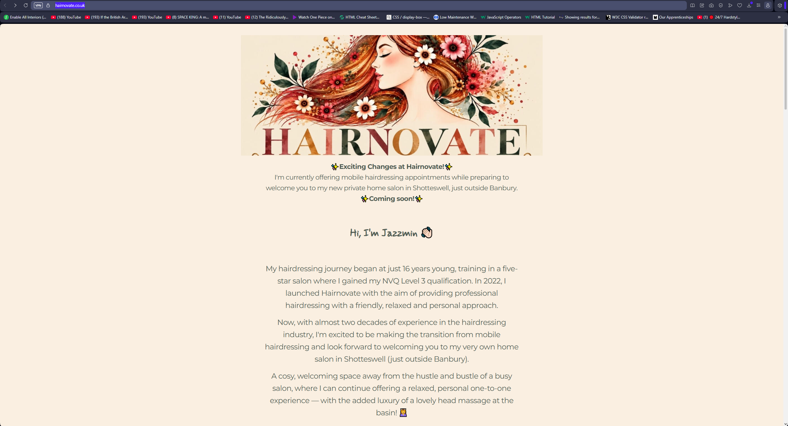
*Desktop landing view showing a text-heavy, single-page structure.* `[P]`

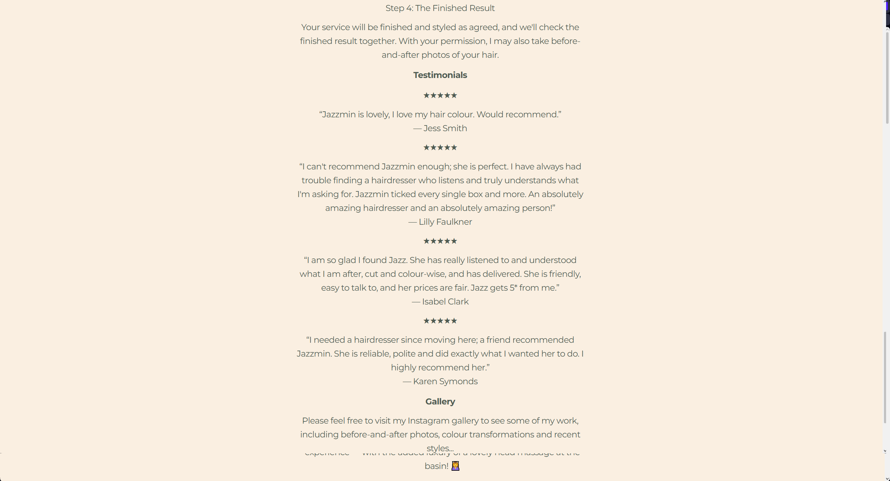
*Star rating component layout highlighted in client feedback.* `[Q]`

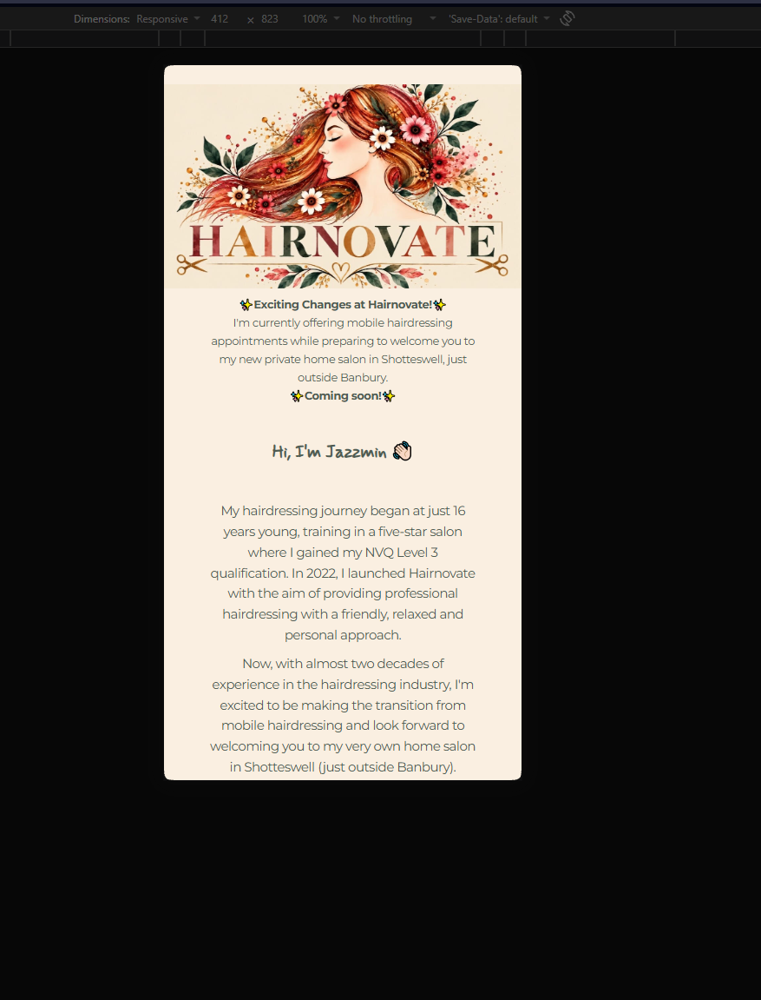
*Mobile responsiveness test at 412px viewport width.* `[P]`

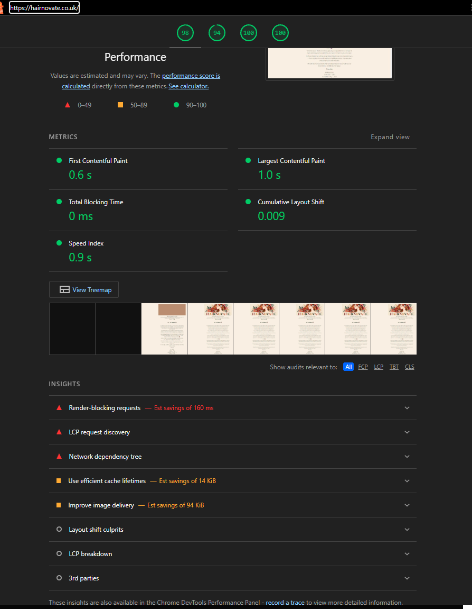
*Lighthouse audit demonstrating near-perfect load speed due to lack of heavy media assets.* `[P]`

**Key Takeaways for "Hair by Lydia":**
- **Features to adopt:** Clear star-rating indicators on client reviews and a transparent price list. `[P]`
- **Features to avoid:** A plain single-page scroll with dense text and no visual portfolio gallery. `[P]`

## Competitor Review: [Emz Hair & Wellness / https://emzhair.co.uk] (accessed 27 October 2026)

| Evaluation Area | Score (Yes / Partial / No) | One-Line Note / Observation |
| :--- | :--- | :--- |
| **1. Layout & Branding** *(Clean, professional, reflects brand personality, uncluttered)* | [Yes] | Clean, modern layout featuring stylish fonts and an active-section indicator in the navigation. `[P]` |
| **2. Gallery / Portfolio** *(Showcases transformations, easy to browse, clear imagery)* | [Partial] | Uses a slideshow concept similar to ours, but the images do not show authentic client work and are low resolution. `[P]` |
| **3. Prices & Services** *(Transparent price list, clear service breakdowns)* | [Yes] | Clear, comprehensive service and price list covering cuts, styling, and specialist colour treatments. `[P]` |
| **4. Enquiry Route / CTA** *(Clear calls-to-action, straightforward contact/enquiry path)* | [Yes] | Features a direct "Request Appointment" / booking form flow that closely matches the structure we want to implement. `[P]` |
| **5. Mobile Responsiveness** *(Adapts cleanly to small screens, easy thumb navigation)* | [Yes] | Adapts fluidly across mobile viewports with smooth touch navigation and legible typography. `[P]` |
| **6. Basic Accessibility** *(Readable fonts, sufficient colour contrast, image alt text present)* | [Partial] | The fonts are legible, but some text needs better contrast, and some images need optimisation and alt text. `[P]` |

## Visual Evidence and Layout Audits (accessed 27 October 2026)

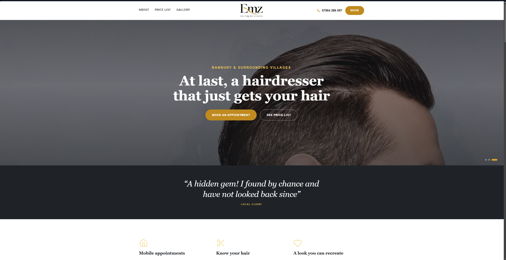
*Desktop landing view highlighting typography and layout structure.* `[P]`

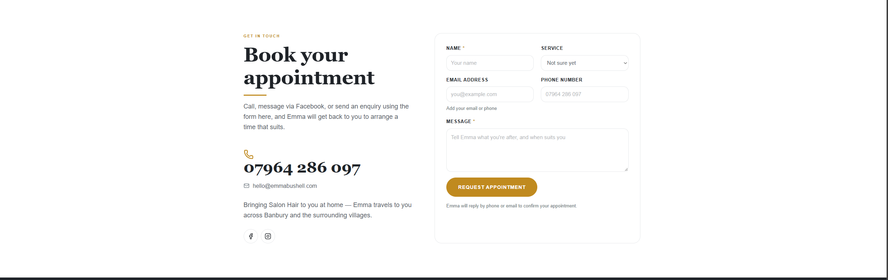
*Enquiry and booking form flow.* `[P]`

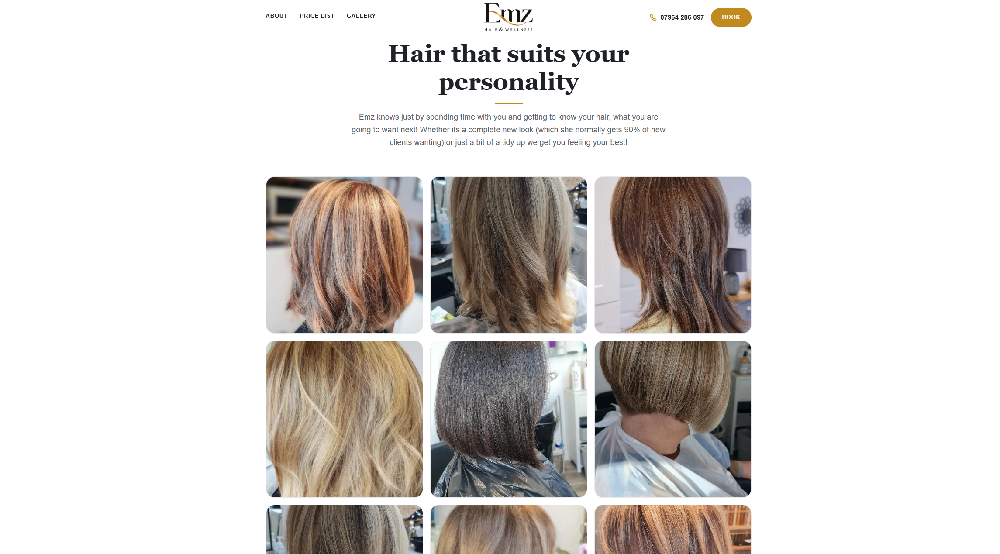
*Photo gallery grid layout.* `[P]`

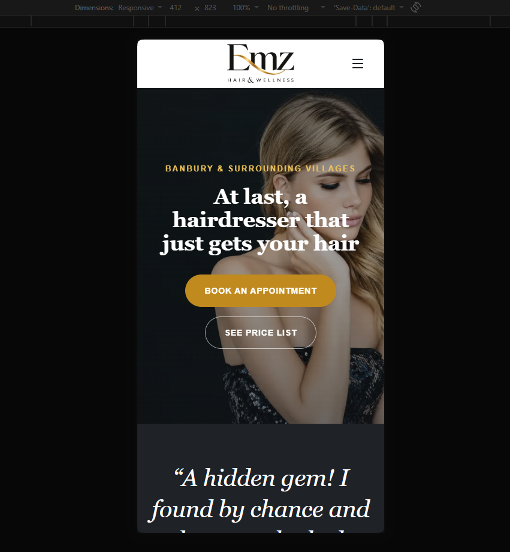
*Mobile responsiveness test at 412px width.* `[P]`

**Key Takeaways for "Hair by Lydia":**
- **Features to adopt:** Clean typography, an active-section indicator in the navigation, and the structured "Request Appointment" enquiry workflow. `[P]`
- **Features to avoid:** Low-resolution photography and slideshows that fail to showcase authentic, high-quality client transformations. `[P]`

## Competitor Review: [Matthew Grant Hairdressing / https://www.matthewgranthairdressing.co.uk] (accessed 27 October 2026)

| Evaluation Area | Score (Yes / Partial / No) | One-Line Note / Observation |
| :--- | :--- | :--- |
| **1. Layout & Branding** *(Clean, professional, reflects brand personality, uncluttered)* | [Yes] | Premium salon branding with a polished layout, featuring a smooth sticky navigation bar and a transparent state at the top of the viewport. `[P]` |
| **2. Gallery / Portfolio** *(Showcases transformations, easy to browse, clear imagery)* | [Yes] | Professional imagery and clear links from the About section to the services and portfolio pages. `[P]` |
| **3. Prices & Services** *(Transparent price list, clear service breakdowns)* | [Yes] | Clearly structured service tiers covering Ladies, Gentlemen, and Children with dedicated booking routes. `[P]` |
| **4. Enquiry Route / CTA** *(Clear calls-to-action, straightforward contact/enquiry path)* | [Yes] | Prominent "Book Online" calls-to-action and direct contact details positioned right where users expect them. `[P]` |
| **5. Mobile Responsiveness** *(Adapts cleanly to small screens, easy thumb navigation)* | [Yes] | Clean mobile scaling with a responsive navigation drawer and easily tappable touch targets. `[P]` |
| **6. Basic Accessibility** *(Readable fonts, sufficient colour contrast, image alt text present)* | [Yes] | Readable text, strong contrast, clean typography, and accessible section layouts. `[P]` |

## Visual Evidence and Layout Audits (accessed 27 October 2026)

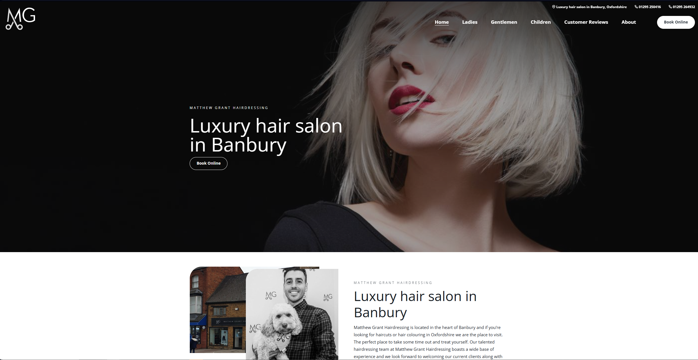
*Top-of-page transparent header state.* `[P]`

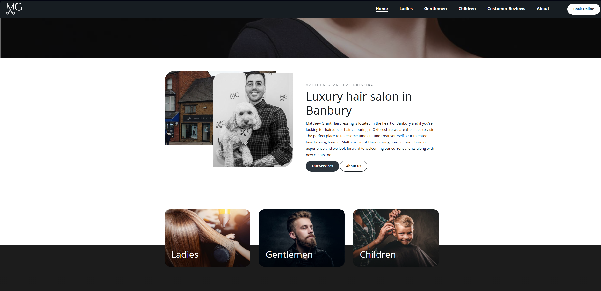
*Solid sticky navigation state on scroll.* `[P]`

*About section cross-page CTA routing.* `[P]`

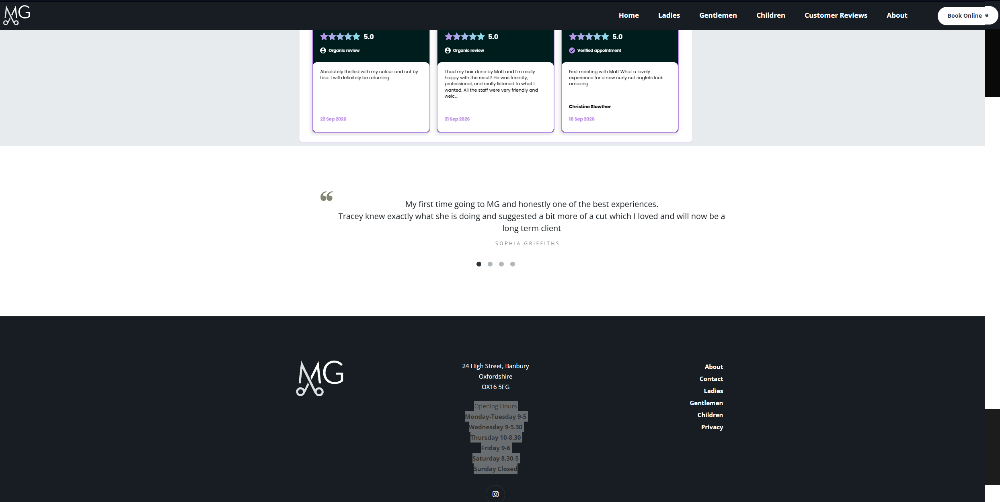
*Continuous review highlight component layout.* `[P]`

**Key Takeaways for "Hair by Lydia":**
- **Features to adopt:** A transparent navigation bar at the top of the viewport, cross-page CTA buttons linking "About" directly to the services and portfolio pages, and a continuous four-review highlight carousel paired with a dedicated reviews page containing all testimonials. `[P]`
- **Features to avoid:** Clunky navigation hierarchies that separate introductory info from clear booking or pricing actions. `[P]`